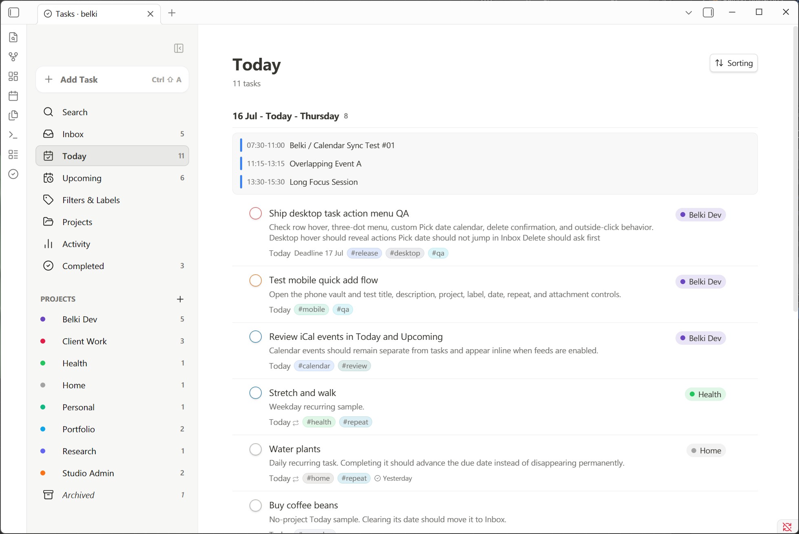
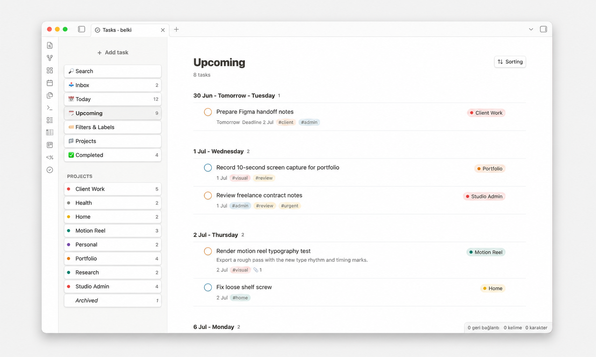
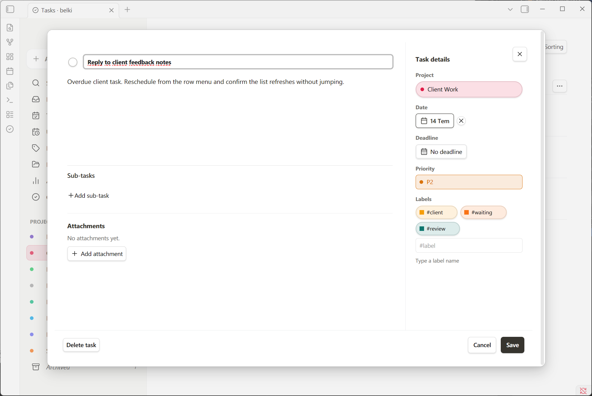
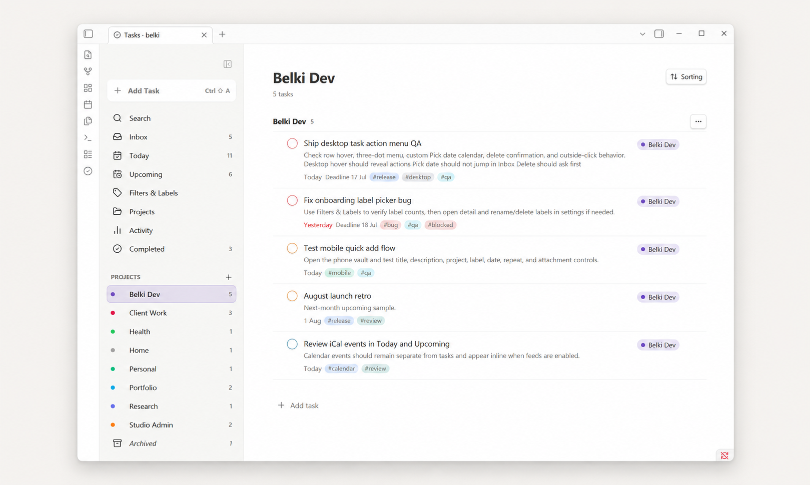
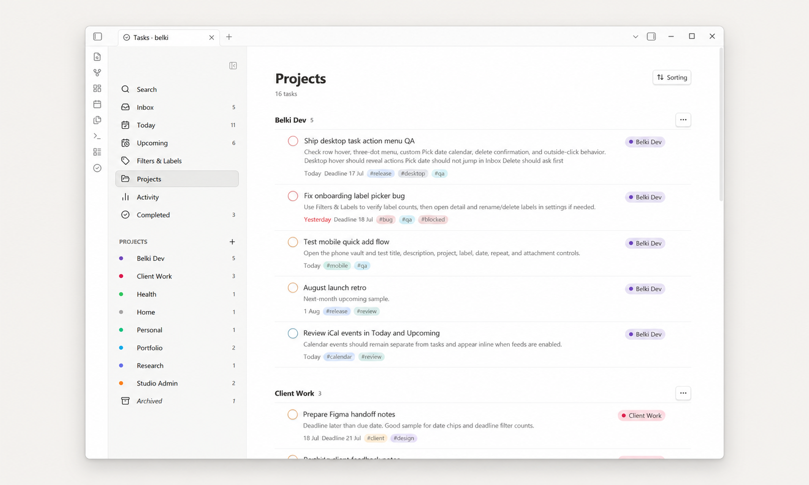
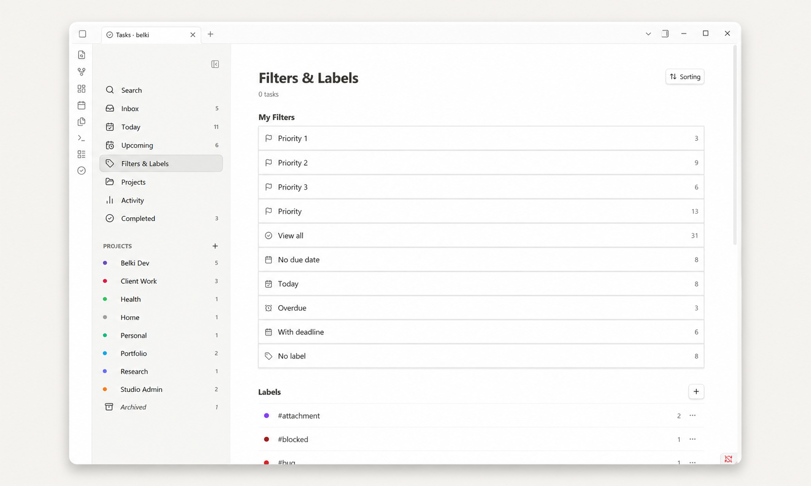
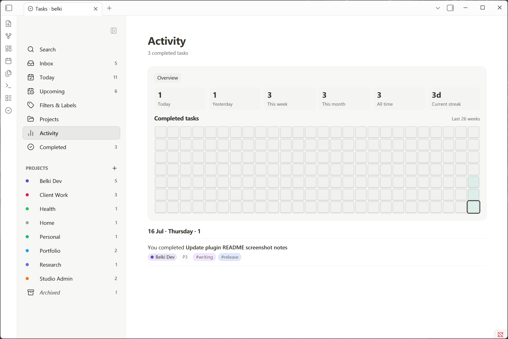
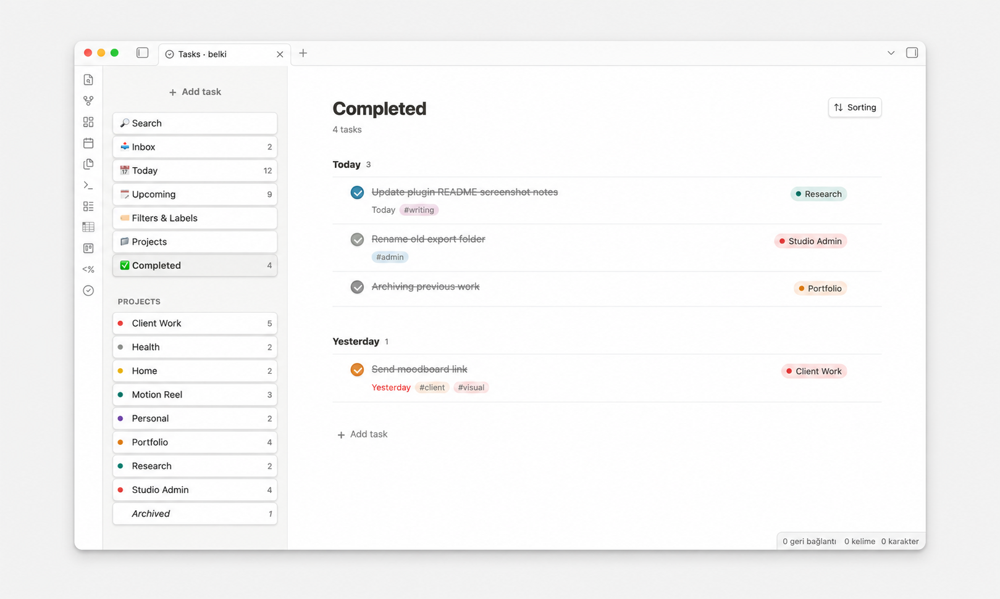
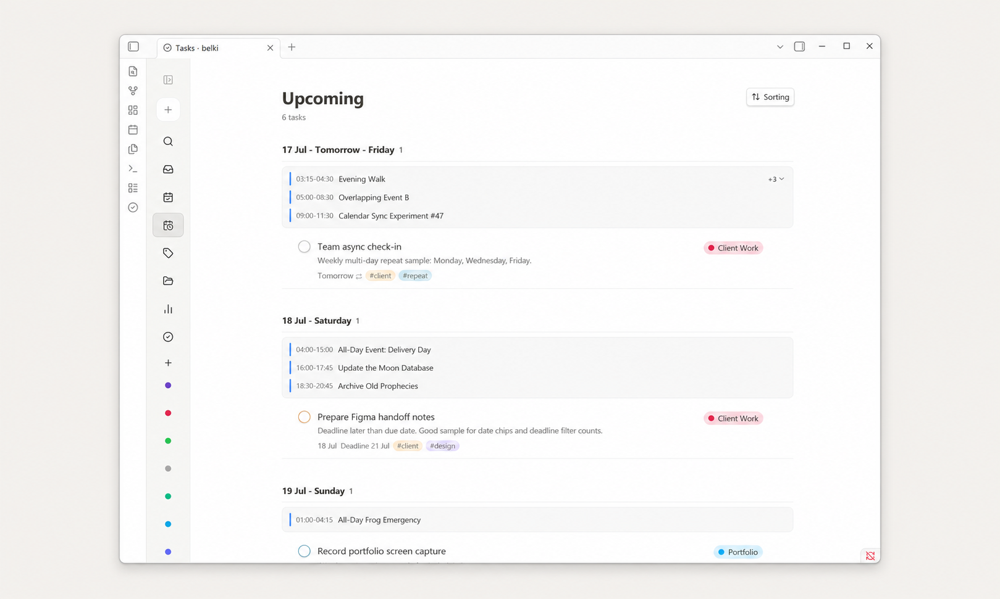

<p align="center">
  
</p>

<h1 align="center">belki</h1>

<p align="center">
  一款类 Todoist 的 Obsidian 的冷静型任务管理插件。<br>
  任务将在本地以 Markdown 文件的形式保存在您的存储库中。
</p>

<p align="center">
  <a href="https://community.obsidian.md/plugins/belki">社区插件</a>
  ·
  <a href="https://github.com/aribuga/obsidian-belki-tasks/releases">发布</a>
  ·
  <a href="docs/README.md">文档</a>
</p>

---

belki 是一款受 Todoist 启发的任务管理工具，它集成在您的 Obsidian Vault 中。您的任务会以纯 Markdown 文件的形式存储，并且完全由您掌控。可选的只读日历订阅不会将日历事件转换为 belki 任务，也不会将事件数据写入任务 Markdown 文件。

belki 的目标是于轻量级的复选框任务插件和繁杂的任务笔记系统之间找到平衡：结构足够完善，可以作为真正的任务管理器，同时又足够小巧，以保持冷静和易于使用。

> Belki不是Todoist 的集成方案，它与 Todoist 没有关系。

---

## 屏幕截图

<p align="center">
  
  
</p>

<p align="center">
  
</p>

<p align="center">
  
  
</p>

<p align="center">
  
  
</p>

<p align="center">
  
  
</p>

---

## 特性

### 视图

- **Inbox** — tasks without a project.
- **Today** — today's tasks, overdue tasks, and optional read-only calendar events.
- **Upcoming** — future tasks grouped by date, plus optional calendar-only dates.
- **Projects** — all projects or one focused project.
- **Filters & Labels** — browse by priority, date, label, or saved smart filters.
- **Activity** — completed-task stats and a 26-week activity heatmap.
- **Completed** — completed tasks grouped by completion date.
- **Search** — quick overlay search across task title, description, project, and labels.
- **Daily Notes** — show completed tasks for a daily note in a belki panel or `belki-completed` code block, with optional auto-insert.

### 任务管理

- Add tasks from the board, the desktop floating composer, the mobile full-screen composer, or the command palette with `belki: Quick Add Task`.
- Use the default `Cmd/Ctrl + Shift + A` shortcut for Quick Add. In an active desktop belki view it opens the contextual composer; outside belki and on mobile it opens the global Quick Add modal.
- The desktop sidebar Add Task button shows the current Obsidian shortcut assignment when one exists.
- Edit title, description, project, priority, due date, deadline, labels, repeat rule, and attachments.
- Complete, uncomplete, reschedule, move, duplicate, and delete tasks.
- Reschedule visible overdue tasks in bulk from the Overdue section.
- Deletion asks for confirmation, including a parent-task warning when direct sub-tasks are involved.
- Use `#label` and `//project` in the title field while adding a task.
- Use wikilinks such as `[[Project brief]]` in task titles and descriptions.
- Sort by Smart, Due date, Priority, Deadline, Created date, Project, or Alphabetical.

### 子任务

- Add sub-tasks from the parent task detail view.
- Parent task rows show a sub-task completion counter.
- Click the counter to expand an inline sub-task preview in the main task list.
- Complete sub-tasks directly from the preview.
- Reorder sub-tasks in the task detail view on desktop.
- Sub-tasks stay hidden from top-level views to avoid duplication.

### 重复性任务

- Daily, weekly, monthly, yearly, and custom repeat rules.
- Calendar-based or completion-based repeats.
- Weekly repeats can target multiple weekdays.
- Recurring tasks advance to the next occurrence when completed.
- Use **Complete permanently** to finish a recurring task.

### 项目、标签和优先级
- Create, rename, archive, delete, and color projects.
- Choose a project color while creating a project, or use Auto.
- Rename or delete labels without deleting tasks.
- Customize project and label colors in settings.
- Priority levels use a Todoist-like model: Priority 1, Priority 2, Priority 3, and default Priority 4.
- Priority is shown subtly on the completion circle.

### 附件

- Attach files to tasks.
- Image attachments show inline previews and a lightbox.
- Other files show as compact file rows.
- Attachments are stored inside your vault.
- Duplicating a task copies attachments into the duplicate task's own attachment folder instead of sharing the original files.

### 移动端

- Responsive single-column mobile layout.
- Full-screen mobile task composer.
- Mobile task detail screen with back navigation.
- Mobile-friendly date picker and repeat controls.
- Task action menu includes Move to Today, Move to Tomorrow, Pick date, Clear date, Duplicate task, and Delete task.
- Mobile keeps the global Quick Add flow rather than using the desktop floating composer.

### 可选集成项

- Multiple iCal calendar subscription events can appear read-only inline inside Today and Upcoming.
- Google Calendar, Apple/iCloud Calendar, and other HTTPS or `webcal://` iCal feeds are supported when they expose a valid iCal feed URL.
- No Calendar page or sidebar item is added.
- Calendar events are not stored as belki tasks and are not written to task Markdown files.
- Calendar subscriptions are read-only. belki does not create, edit, delete, import, export, or two-way sync calendar events.
- See [Calendar Subscriptions](docs/calendar-subscriptions.md) for setup and security details.

---

## 如何运作

belki creates a data folder in your vault. The default location is:

```text
_belki_files/
├─ Data/
│  └─ YYYY-MM.md
└─ Attachments/
   └─ <task-id>/
```

Each task is a Markdown list item with metadata:

```markdown
- [ ] Write portfolio case study draft
  id:: task-example
  created:: 2026-07-05
  due:: 2026-07-08
  deadline:: 2026-07-10
  project:: Client Work
  priority:: P2
  description:: Keep it short and visual.
  labels:: writing, portfolio
```

Tasks without a real project simply omit `project::` and appear in Inbox. Completed tasks use `[x]` and include a `completed::` date. The data folder path is configurable in settings.

See [Markdown storage](docs/markdown-storage.md) for full details.

---

## Obsidian 搜索和排除文件

belki stores task data as local Markdown files in the configurable data folder, `_belki_files/` by default. Since these are real vault files, users who do not want belki task data to appear in Obsidian search, graph, or unlinked mentions should add `_belki_files/` to:

> Obsidian Settings → Files and links → Excluded files

belki itself only reads its configured data folder and does not scan the whole vault. Future vault-wide checklist import should respect Obsidian excluded folders.

---

## 安装

### 社区插件

1. Open Obsidian Settings → Community plugins.
2. Click **Browse** and search for `belki`.
3. Install and enable the plugin.
4. Run the command `belki: Open`.

Community listing: [community.obsidian.md/plugins/belki](https://community.obsidian.md/plugins/belki)

### 手动安装

1. Download `manifest.json`, `main.js`, and `styles.css` from a [GitHub release](https://github.com/aribuga/obsidian-belki-tasks/releases).
2. Create this folder inside your vault:
   ```text
   .obsidian/plugins/belki/
   ```
3. Copy the three files into that folder.
4. Reload Obsidian.
5. Enable **belki** in Settings → Community plugins.
6. Run the command `belki: Open`.

---

## 快速入门

1. Install and enable belki.
2. Run `belki: Open` from the command palette.
3. Click **+ Add task** or run `belki: Quick Add Task`.
4. Add a title, date, project, label, priority, or repeat rule.
5. Tasks with no project land in **Inbox**.

See [Getting started](docs/getting-started.md) for a walkthrough.

---

## 文档

| 页面 | 描述 |
|---|---|
| [开始](docs/getting-started.md) | 安装并进行第一步 |
| [任务](docs/tasks.md) | 创建、编辑和完成任务 |
| [项目和收件箱](docs/projects-and-inbox.md) | 项目和收件箱的工作原理 |
| [子任务](docs/subtasks.md) | 添加和管理子任务 |
| [重复任务](docs/recurring-tasks.md) | 重复规则和行为 |
| [标记与优先级](docs/labels-and-priorities.md) | 标记任务并设置优先级 |
| [排序和筛选](docs/sorting-and-filtering.md) | 排序、分组和筛选 |
| [附件](docs/attachments.md) | 将文件和图像添加到任务中 |
| [活动](docs/activity.md) | 已完成任务历史记录和统计数据 |
| [每日笔记](docs/daily-notes.md) | 显示每日笔记日期已完成的任务 |
| [移动端](docs/mobile.md) | 在移动端上使用 Belki |
| [设置](docs/settings.md) | 配置选项 |
| [Markdown 储存](docs/markdown-storage.md) | Belki 如何存储任务数据 |
| [FAQ](docs/faq.md) | 常见问题 |

---

## Development

```bash
pnpm install
pnpm run build
```

开发过程中：

```bash
pnpm run dev
```

构建输出将写入：

- `main.js`
- `styles.css`
- `manifest.json`

---

## 发布清单

- Update `manifest.json`, `package.json`, and `versions.json`.
- Run `pnpm install --frozen-lockfile`.
- Run `pnpm run typecheck`, `pnpm test`, and `pnpm run build`.
- Confirm `manifest.json`, `main.js`, and `styles.css` are present.
- Create a GitHub release whose tag exactly matches the manifest version.
- Upload `manifest.json`, `main.js`, and `styles.css` as release assets.

See [RELEASE.md](RELEASE.md) for the full process.

---

## 隐私和网络使用

belki does not add telemetry and does not require an account. It reads and writes task data only inside its configured vault data folder.

If you enable optional calendar subscriptions, belki fetches only the iCal feed URLs you configure. Those feed URLs are stored locally in plugin settings, masked in the settings UI, and should be treated as private secrets when they contain calendar access tokens.

---

## 改进计划

These are directions being explored, not commitments:

- Natural language date parsing (`tomorrow`, `next Friday`, `in 3 days`).
- Standalone recurring task refinements.
- Vault-wide checklist import that respects Obsidian excluded files and folders.
- Better lightweight GTD-style workflows such as Inbox, Next Actions, Waiting, Someday/Maybe, and Projects.
- Minimal, understandable settings with clear defaults and optional advanced workflows.

---

## 贡献与反馈

Bug reports and feature requests are welcome at [github.com/aribuga/obsidian-belki-tasks/issues](https://github.com/aribuga/obsidian-belki-tasks/issues).

---

## 作者

Created by Yasin Aribuga.

---

## 许可证

MIT. See [LICENSE](LICENSE).
